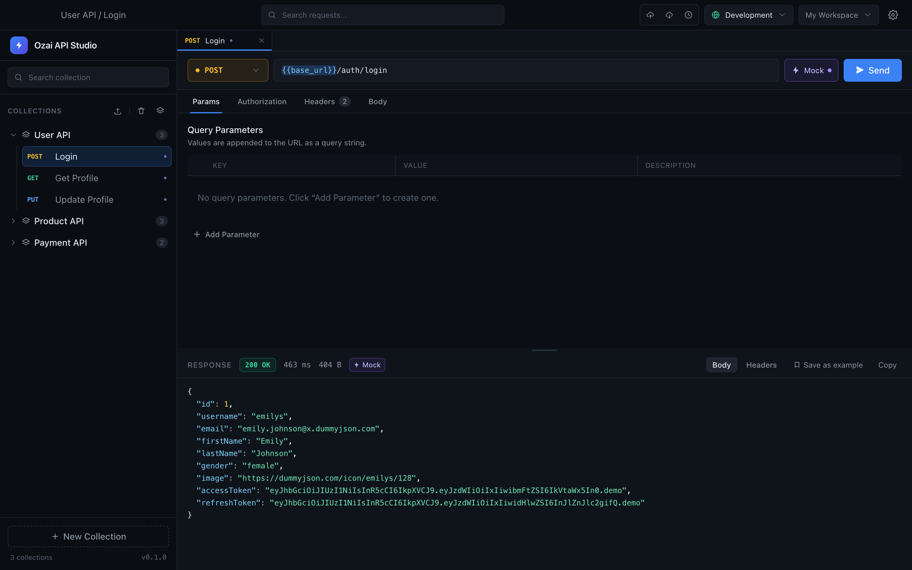
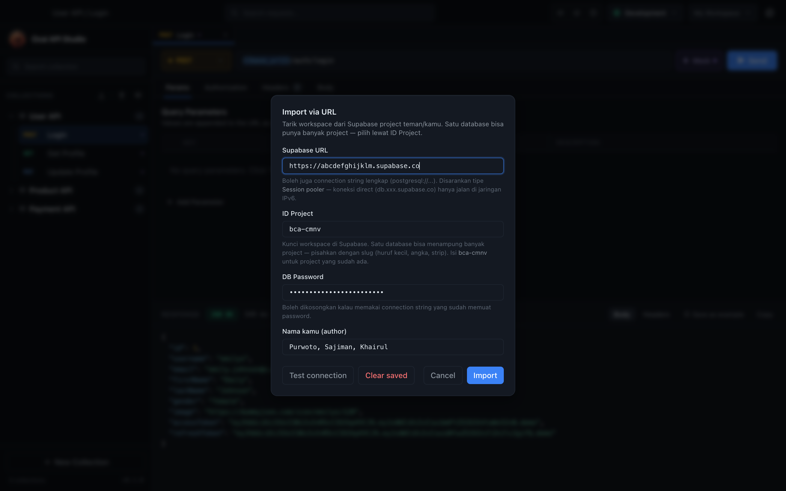
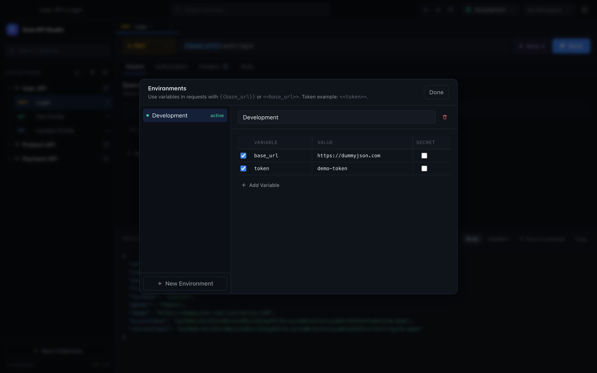
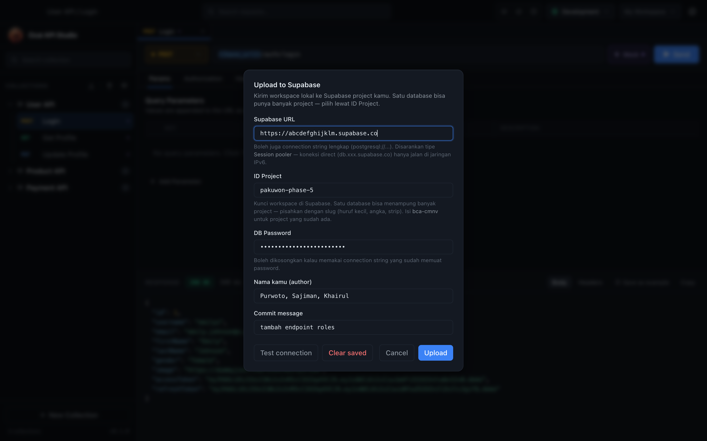

# Ozai API Studio

A fast, keyboard-friendly desktop API client for macOS and Windows. Build collections, send HTTP requests, keep environment variables, save response examples, and publish a hosted mock API — all from one app.

Built with Electron 31, React 18, TypeScript, and Tailwind CSS. Sync uses a direct Postgres connection to Supabase (no extra backend server).



## Download

Grab the latest build from the [Releases page](https://github.com/mamzky/ozai-api-studio/releases/latest). Assets for `v0.1.1`:

| Platform | File | Size |
| --- | --- | --- |
| macOS (Apple Silicon) | [`Ozai.API.Studio-0.1.1-arm64.dmg`](https://github.com/mamzky/ozai-api-studio/releases/download/v0.1.1/Ozai.API.Studio-0.1.1-arm64.dmg) | 96.5 MB |
| macOS (Apple Silicon, portable) | [`Ozai.API.Studio-0.1.1-arm64-mac.zip`](https://github.com/mamzky/ozai-api-studio/releases/download/v0.1.1/Ozai.API.Studio-0.1.1-arm64-mac.zip) | 94.2 MB |
| Windows 10/11 (x64) | [`Ozai.API.Studio.Setup.0.1.1.exe`](https://github.com/mamzky/ozai-api-studio/releases/download/v0.1.1/Ozai.API.Studio.Setup.0.1.1.exe) | 74.5 MB |
| Windows (x64, portable) | [`Ozai.API.Studio-0.1.1-win.zip`](https://github.com/mamzky/ozai-api-studio/releases/download/v0.1.1/Ozai.API.Studio-0.1.1-win.zip) | 103.5 MB |

The repository is public, so the links above start the download directly. Older builds are listed on the [releases page](https://github.com/mamzky/ozai-api-studio/releases).

Intel Macs and Linux are not part of the release matrix yet. Build from source instead (see [Run from source](#run-from-source)).

### Install on macOS

1. Open the `.dmg` and drag **Ozai API Studio** into **Applications**.
2. First launch: right-click the app → **Open** → **Open**. Builds are not notarized yet, so double-clicking may be blocked by Gatekeeper.
3. If macOS still refuses to launch it, clear the quarantine flag:

   ```bash
   xattr -dr com.apple.quarantine "/Applications/Ozai API Studio.app"
   open "/Applications/Ozai API Studio.app"
   ```

4. Development only — if Electron itself is blocked with a "contains malware" message after `npm install`, run:

   ```bash
   npm run fix:electron
   ```

### Install on Windows

1. Run `Ozai API Studio Setup 0.1.0.exe`.
2. SmartScreen may warn because the installer is unsigned: **More info** → **Run anyway**.
3. Prefer the portable build? Extract `Ozai API Studio-0.1.0-win.zip` and run `Ozai API Studio.exe`. If Windows marks the file as blocked:

   ```powershell
   Get-ChildItem -Recurse | Unblock-File
   ```

## Screenshots

| Import / export a project | Environments with variables and secrets |
| --- | --- |
|  |  |

| Upload a project snapshot | Mock response without a network call |
| --- | --- |
|  |  |

## Features

- **Collections and requests** — collection tree, search, rename, duplicate, delete, close/clear, drag-free compact layout.
- **Multi-tab requests** — open several requests at once, switch tabs, close with the tab or middle-click.
- **Full request editor** — method, URL with `{{variable}}` highlighting, params, auth (Bearer, Basic, API key), headers, body (`none`, JSON, raw).
- **Response viewer** — status, latency, size, highlighted JSON, response headers, copy headers.
- **Mock mode per request** — send returns the saved example response without touching the network. Import an OpenAPI contract and the first example is used automatically.
- **Examples** — save any response as a documentation example under a request, with its own status and name. Separate from Mock.
- **Environments** — `{{variable}}` resolution, multiple environments, secret flags. Secret values never leave the machine during sync.
- **Import** — paste a cURL command in the URL bar, import OpenAPI JSON, or import a workspace export with **Add new only** / **Replace existing**.
- **Local history** — every upload/import is snapshotted locally, with rollback.
- **Supabase sync** — upload and import workspaces over a direct Postgres connection, with commit history per project.
- **Hosted mock API** — a Supabase Edge Function serves your saved examples as real HTTP endpoints ([docs](supabase/README.md)).

## Multi-project sync (Supabase)

One Supabase database can hold many projects. Every project is identified by an **ID Project** slug (for example `bca-cmnv` or `pakuwon-phase-5`) stored in the `id_project` column of `studio_workspace` and `studio_commits`.

1. Click the upload icon in the top bar.
2. Fill in **Supabase URL** (project URL, a bare project ref, or a full `postgresql://` connection string), **ID Project**, **DB Password**, and your name.
3. Upload sends the local workspace and creates a commit snapshot for that project only.
4. `Import via URL` with the same **ID Project** pulls that project's workspace back.

The tables are created and migrated automatically on the first connection. No manual SQL is required. Commit history is filtered per project, so uploading `pakuwon-phase-5` never mixes with `bca-cmnv`.

Recommended connection type is **Session pooler** (`...pooler.supabase.com`). Direct connections (`db.<project>.supabase.co`) only work on networks with IPv6; the app falls back to scanning pooler regions otherwise.

> Local builds store the sync URL, project, author, and DB password in the app data file on your machine. Do not sync a shared machine profile that contains production database passwords.

## Hosted mock API

`supabase/functions/mock` serves saved examples as real HTTP responses:

```bash
curl -H "apikey: $SUPABASE_PUBLISHABLE_KEY" \
  "https://<project-ref>.supabase.co/functions/v1/mock/api/v1/users?__project=pakuwon-phase-5"
```

- Pick a project with `?__project=<slug>` or `X-Ozai-Project: <slug>`.
- Pick an example with `?__example=403` or `X-Ozai-Example: 403`.
- Discovery: `/__ozai/health` (active project + available projects) and `/__ozai/routes`.

Deployment, auth, and matching rules live in [`supabase/README.md`](supabase/README.md).

## Run from source

Requirements: Node.js 20+, npm, and macOS 12+ or Windows 10/11.

```bash
npm install          # also re-signs Electron on macOS when needed
npm run dev          # development with hot reload
npm run typecheck    # TypeScript check, no build
npm run build        # production bundle into out/
npm run preview      # preview the production bundle
```

### Build installers

```bash
npm run package       # macOS: dmg + zip in dist/
npm run package:mac   # macOS only
npm run package:win   # Windows x64: NSIS installer + portable zip
```

Artifacts land in `dist/` (ignored by Git). Windows installers can be produced from macOS, but they are unsigned.

### Release a version

Pushing a `v*` tag triggers the GitHub Actions workflow, which builds macOS and Windows artifacts and attaches them to a draft-free release:

```bash
git tag v0.1.0
git push origin v0.1.0
```

You can also run **Release** manually from the Actions tab; artifacts are uploaded as workflow artifacts.

## Project structure

```text
src/
  main/            Electron main process, HTTP transport, Supabase sync, storage IPC
  preload/         contextBridge that exposes window.api to the renderer
  renderer/src/
    App.tsx        workspace state and main interactions
    components/    UI components (tabs, editors, dialogs, tree, viewer)
    data/          default collections and environments
    hooks/         useAppData (load + autosave)
    lib/           request builder, environments, cURL, OpenAPI, formatting
    services/      local storage, sync client, mock transport
  shared/types.ts  types shared between main and renderer
supabase/
  functions/mock/  Edge Function that serves saved examples
  migrations/      studio_workspace + studio_commits schema and RLS
docs/screenshots/  README images
```

## Security notes

- `.env`, `secret.txt`, `*.local.json`, `node_modules`, `out/`, and `dist/` are never committed.
- Environment variables flagged as secret are emptied before an upload.
- RLS is enabled on `studio_workspace` and `studio_commits`; only the Postgres role and the Edge Function service role can read them.
- The Supabase service role key lives only inside the Edge Function secrets. Never ship it to the renderer.
- Examples can contain real tokens or customer data. Sanitize them before uploading to a shared project.

## License

MIT
